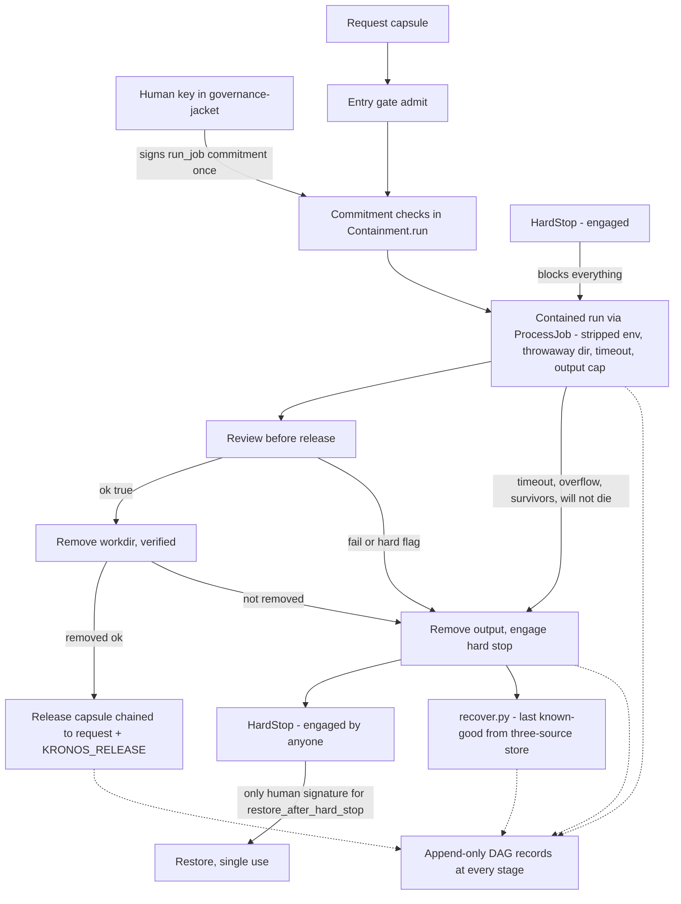

# vega-two-gate-sdk — Architecture

## 1. The organism

This repo is layer 4 (contain) of the 16-layer Vega SDK family. Layers below provide: layer 0, vega-custody-sdk — capsules, the DAG record, the hash-chained ledger, the three-source store and the bounded processes this kit runs jobs in; layer 1, vega-governance-jacket-sdk — human-only single-use commitments, the signing and verification machinery, and the entry gate. Layer 3 (pareah, the doorway) sits beside the containment path, not under it. Above, layers 5 to 15 consume the records this kit writes — lessons, knowledge, foresight, deliberation and the family view — and no published kit currently requires this one directly: it is the containment layer for hosted, bounded execution.

```
                 +--------------------------+
                 |   THE HUMAN (the owner)  |  holds the only signing key;
                 |                          |  spends it one action at a time
                 +------------+-------------+
                              v single-use signed commitments
 15 assemble   vega-umbrella-sdk
 14 deliberate vega-council-sdk / vega-galaxy-sdk
 13 watch      vega-governance-feed-sdk
 12 verify     vega-metacog-sdk
 11 reason     vega-reasoning-sdk
 10 observe    vega-trace-sdk
  9 interface  vega-terminal-sdk
  8 learn      vega-train-sdk
  7 knowledge  vega-dkg-lattice-sdk
  6 conduct    vega-harness-sdk
  5 memory     vega-librarian-sdk
>>> 4 contain  vega-two-gate-sdk          <<< THIS REPO
  3 adapt      vega-pareah-sdk
  2 seal       vega-superproof-sdk
  1 authority  vega-governance-jacket-sdk   (dependency: commitments, entry gate)
  0 record     vega-custody-sdk             (dependency: capsules, DAG, ledger,
                                             store, bounded processes)
```

## 2. Internal drawing: the containment corridor

Two flows run through this kit and never mix. AUTHORITY (marked A) flows only from the human-signed commitment through the gates. DATA (marked D) flows through capsules and records. Boxes are real modules; the gate, ledger, DAG, store and job machinery are owned by the two dependency kits and called from here.

```
                 HUMAN key (in vega-governance-jacket-sdk)
                        |
                        | A: signs job_params(job_id, argv, request)
                        v          for action run_job, once
   request capsule ---+-------------------------+
        D             |                         |
        v             v                         v
 +=============+  +=================+   +===============+
 | ENTRY GATE  |  |   COMMITMENT    |   |   HARD STOP   |<---- anyone can
 | (jacket)    |  |   CHECKS        |   |  HardStop in  |      engage [A or D]
 | admit(req)  |  | minted, kind,   |   |  contain.py   |
 +======|======+  | action, expiry, |   +===|=======^===+
        |         | job binding,    |       |       |
        |         | single use      |       |       | only human signature
        |         +========|========+       |       | for restore_after_
        |                  |                |       | hard_stop lifts it [A]
        v                  v                v       |
 +===================================================================+
 |                     Containment.run  (contain.py)                 |
 |  while stop engaged: nothing runs  ------------------------------+|
 |                                                                   ||
 |  identify --> locate --> run contained --> review --> remove -->  ||
 |  [record]     [record]   ProcessJob        [record]   [record,   ||
 |                           (custody):       reviewer    verified]  ||
 |                           stripped env,    verdict      |         ||
 |                           throwaway dir,     |          |         ||
 |                           timeout, cap       |          |         ||
 +=================|======================|=====|==========|=========+
                   |                      |     |          |
              failure paths ----------+---+-----+----------+
                                      v
                          remove (verified) --> engage HARD STOP
                                      |
                                      v
                     +---------------------------------+
                     |  recover.py                     |
                     |  last known-good SAVE from the  |
                     |  three-source store (custody);  |
                     |  bytes must re-hash to digest;  |
                     |  every recovery recorded        |
                     +---------------------------------+

 success only: released output capsule (chained to the request) + KRONOS_RELEASE
 every stage, success or failure: append-only DAG records (custody)
```

## 3. Mermaid version



## 4. Sequence: one contained job, end to end

```
 human          Containment.run      entry gate    ProcessJob     reviewer    HardStop    DAG
   |                    |                 |            |             |          |        |
   |-- sign run_job --> |                 |            |             |          |        |
   |   (job_params)     |-- engaged? ------------------------------------------>|        |
   |                    |<------------------------------------------ no --------|        |
   |                    |-- admit(req) -->|            |             |          |        |
   |                    |<- ok -----------|            |             |          |        |
   |                    |-- verify commitment: minted, unexpired, WCOMMIT,      |        |
   |                    |   action run_job, bound to this job, not replayed     |        |
   |                    |-- identify ------------------------------------------ record ->|
   |                    |-- start ------> |            |             |          |        |
   |                    |-- locate ------------------------------------------- record ->|
   |                    |-- stdin = capsule data, bounded read under cap ------> |        |
   |                    |<- out, err, ok/timeout/overflow ---------------------  |        |
   |                    |   [timeout/overflow: verified tree kill, teardown,    |        |
   |                    |    engage stop, refuse] ----------------------------> engage ->|
   |                    |-- survivors? -- |            |             |          |        |
   |                    |-- review(out) --------------------------------------> |        |
   |                    |                 |            |   verdict   |          record ->|
   |                    |   [fail: remove output, engage stop if hard/exit!=0,  |        |
   |                    |    refuse] ------------------------------------------> engage->|
   |                    |-- remove workdir, verify gone ------------------------------- >|
   |                    |-- release capsule chained to request ------------------------ >|
   |<- output capsule --|                 |            |             |          |        |
```

## 5. Trust boundaries

- **Human / model.** The signing key never lives on the model's side. Authority enters only as a minted, single-use `WCOMMIT` commitment whose `action_hash` binds one exact job (enforced by `Containment.run` checks against `ledger.verify` and the jacket commit path). A model cannot mint, widen, replay or transfer it.
- **Caller / contained job.** The job process trusts nothing from the parent: stripped environment, throwaway workdir, no shell interpretation of argv, bounded stdin/stdout/stderr, wall-clock timeout, verified tree kill, survivor detection (`contain.py` + custody `ProcessJob`).
- **Contained job / record.** Teardown never trusts the workdir: symlinks and special files are skipped, never followed; oversized files are skipped, never read whole; removal is verified, not assumed (`contain.remove`).
- **Anyone / hard stop.** Engaging is trust-free (anyone, anything, any reason). Lifting crosses the strongest boundary in the kit: a ledger-verifiable human commitment for exactly `restore_after_hard_stop`, single-use per nonce; forged, replayed or hand-appended records do not count, and an unreadable record or missing ledger keeps the stop engaged (`contain.HardStop`).
- **This kit / dependencies.** Containment trusts custody for capsule integrity, DAG hash-linking, ledger verification, store digests and job-object process control, and trusts the jacket for signatures, commitments and entry admission. Those are down-layer owners; this kit grows no copy of them.
- **Store / recovery.** Recovery trusts no single copy: bytes count only if they re-hash to the recorded digest in at least one of the three sources (`recover.last_good`).

**Standing honest limits.** Process-level containment, not an OS sandbox — run hostile code in a VM or container; on POSIX a descendant that detaches is a documented limit. Whoever can write both the chain files and the ledger files can forge both — keep a second replica or witness the roots off-machine. The default reviewer approves; the kit ships none.
