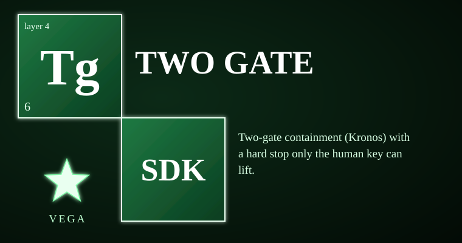

# vega-two-gate-sdk



Two-gate containment (Kronos) with a hard stop only the human key can lift. This kit owns one concern in the Vega family: **containment between two gates and the hard stop**. It runs a job as a separate, bounded process. Nothing enters without passing the entry gate, and nothing leaves without passing review at the exit gate. When anything goes wrong it removes the output, engages a hard stop that freezes all future runs, and waits for a human signature to lift it. Think of a bank vault corridor: money cannot walk out the back door, and if the alarm trips the whole branch stops until a manager with the only key says otherwise.

> **Licensing.** Source-available, not open source. Free for personal use; free for registered small businesses (under US$1M revenue and valuation); everyone else needs a commercial license (see LICENSE; for a commercial license write to jasonblasiak.ai.mail@gmail.com). Patent pending. Draft licence text, not yet reviewed by an attorney.

Package: `vega_twogate` (src layout). Depends on: vega-custody-sdk, vega-governance-jacket-sdk.

## Why this exists

An agent that can run programs is useful and dangerous in the same motion. The program it runs might hang, flood memory, spawn children that outlive it, print something that should not leave, or drop residue on disk. Telling the model to be careful does not stop any of that. A policy is a promise. A model checking its own output is the thing being checked doing the checking.

This kit does not ask the model to behave. It puts the run inside a corridor with two gates. At the entry gate the request capsule must verify, and a human-signed commitment must exist for exactly this job: this job id, this program, these arguments, this request capsule. Inside the corridor the job runs as a separate process with a stripped environment, a throwaway working directory, a wall-clock timeout and an output cap. On timeout the whole process tree is killed, and the kill is verified rather than assumed.

At the exit the output is reviewed before it is released. It leaves only as a capsule chained back to the request, and only after the working directory is confirmed gone. Every failure path removes the output, refuses the run, and for the failures that matter — a timeout, a process that will not die, a descendant that outlived the job, a hard-flagged review, a non-zero exit code, a work folder that will not delete — engages the hard stop.

The hard stop is a one-way ratchet. Anyone or anything can engage it. Nothing runs while it is engaged. Only a valid human signature for exactly `restore_after_hard_stop` lifts it, and deleting the marker file does not help because the stop also lives in the hash-chained record. After containment removes something, `recover.py` restores the last known-good state from the three-source store: a copy counts only if its bytes re-hash to the recorded digest.

## Capabilities

| Capability | How you can check it |
|---|---|
| Contained run: separate process, stripped environment, throwaway workdir, wall-clock timeout, output cap | `kronos/contain.py` — `Containment.run`, `_run_bounded`; `tests/test_kronos.py`, `tests/redteam_1_containment.py` |
| Entry gate: only a verified request capsule starts a run | `Containment.run` calls `entry_gate.admit(request)`; `tests/test_kronos.py` (tampered request refused) |
| Single-use, job-bound human commitment required to run | `Containment.run` commitment checks (minted, unexpired, `WCOMMIT`, action `run_job`, `action_hash` over `job_params`, replay scan); `tests/redteam_2_state_and_replay.py` (`JobBinding`, replay, forgery) |
| Review before release: output leaves only on an explicit ok true | `contain.review`; `tests/redteam_3_audit_findings.py` (`F3_ReviewerFailures`) |
| Verified kill: an unconfirmed kill is reported and stops everything | `contain._kill_tree`, `ProcessJob.kill` / `survivors` checks; `tests/redteam_1_containment.py`, `tests/redteam_3_audit_findings.py` (`F2_DescendantsOutliveTheJob`) |
| Verified teardown: files hashed, symlinks skipped, removal retried and confirmed | `contain.remove`; `tests/redteam_1_containment.py` (symlink canary, residue, secret-named files) |
| Hard stop: anyone engages, only the human key lifts, survives restart and marker deletion, fails closed on an unreadable record, forged restores do not count | `contain.HardStop`; `tests/test_kronos.py`, `tests/redteam_2_state_and_replay.py`, `tests/redteam_3_audit_findings.py` (`F1_ForgedRestore`) |
| Recovery of the last known-good state from the three-source store, corrupted copies skipped, recorded | `kronos/recover.py`; `tests/test_kronos.py` (recovery checks) |

STATUS.md marks `kronos` BUILT and tested. An operating-system-level sandbox is DESIGNED ONLY and is not in this repo.

## Where it sits in the family

Layer 4, contain. Below it, vega-custody-sdk (layer 0) owns the capsules, the DAG record, the hash-chained ledger, the three-source store and the bounded processes; vega-governance-jacket-sdk (layer 1) owns human-only commitments, the signing key material and the entry gate. This kit owns the corridor between the two gates and the hard stop, and calls those two owners instead of copying them. No other published kit in the family registry currently lists it as a dependency. Above it, layers 5 to 15 build memory, conduct, knowledge, reasoning and the family view on top of records this kit writes.

```
 15 assemble   vega-umbrella-sdk
 14 deliberate vega-council-sdk / vega-galaxy-sdk
 13 watch      vega-governance-feed-sdk
 12 verify     vega-metacog-sdk
 11 reason     vega-reasoning-sdk
 10 observe    vega-trace-sdk
  9 interface  vega-terminal-sdk
  8 learn      vega-train-sdk
  7 knowledge  vega-dkg-lattice-sdk
  6 conduct    vega-harness-sdk
  5 memory     vega-librarian-sdk
>>> 4 contain  vega-two-gate-sdk        <-- THIS REPO
  3 adapt      vega-pareah-sdk
  2 seal       vega-superproof-sdk
  1 authority  vega-governance-jacket-sdk   (dependency)
  0 record     vega-custody-sdk             (dependency)
```

One family, one organism: every SDK owns exactly one concern and uses the owner of every other concern instead of growing its own copy.

## Quick start

Put the `src` directory of this repo, and of vega-custody-sdk and vega-governance-jacket-sdk, on `PYTHONPATH`. Then:

```python
from vega_twogate.kronos import contain

# The exact parameters a human signs to authorise ONE job. Pure function, no I/O.
request = {"prefix_hash": "ab" * 32}
params = contain.job_params("job-1", ["python", "-I", "script.py"], request)
print(params["job_id"], params["argv"])
# job-1 ['python', '-I', 'script.py']
# A commitment's action_hash must equal humanauth.action_hash(params) for the run
# to be admitted in the default bind_job=True mode.
```

A full run wires an `EntryGate`, a `HardStop`, a `Dag` and a `Ledger` from the two dependency kits into `contain.Containment`, then calls `run(job_id, argv, request, commitment, timeout=..., reviewer=...)`. `tests/fixture_kronos.py` shows the whole assembly in about twenty lines.

## What it does NOT do

- **Not a security review.** Passing tests and a clean automated scan are not proof of safety; REVIEW.md says so in terms.
- **Containment is process-level, not an OS sandbox.** The limit is printed in the source docstring: run hostile code inside a VM or container. STATUS.md lists the OS-level sandbox as DESIGNED ONLY.
- **The licence and this README are policy, not legal advice.** The licence text is a draft that no attorney has reviewed.
- **The default reviewer approves.** With `reviewer=None`, `review` records a default ok verdict. This kit ships no reviewer; a real deployment must supply one.
- **One disk is not enough to trust a restore.** The source states it plainly: whoever can write both the chain files and the ledger files can forge both. Keep a second ledger replica or witness the roots off the machine.
- **On POSIX a descendant that detaches is a documented limit.** The test suite skips that case off Windows and points at a cgroup or a container.
- **It does not make a model aligned, truthful or kind.** It bounds what can run and what can leave. The human is still the weak point.

## Tests

52 tests in 4 files, all passing (counts from STATUS.md and REVIEW.md). Files: `test_kronos.py` (selftest script), `redteam_1_containment.py`, `redteam_2_state_and_replay.py`, `redteam_3_audit_findings.py` (unittest red-team passes), plus `fixture_kronos.py`, a shared fixture that is not itself a test file. Some red-team tests are Windows-specific and skip elsewhere.

Run: put this repo's `src` and the `src` of both dependencies on `PYTHONPATH`, then run each file in `tests/`, for example `python tests/redteam_1_containment.py`. Each file exits 0 only if every check passes.

## Status & honesty

This is a reference implementation and a work in progress. It has not been independently security-reviewed, and the cryptography across the family has not been expert-reviewed: the code is plain software written for clarity. STATUS.md is canonical for what is BUILT versus DESIGNED ONLY, and SECURITY.md carries the threat model.

Patent pending (U.S. provisional application 64/178,949 and others).

This kit details one branch of a broader filed architecture. The remaining branches are the subject of filed disclosures and are outside the scope of this repository.
